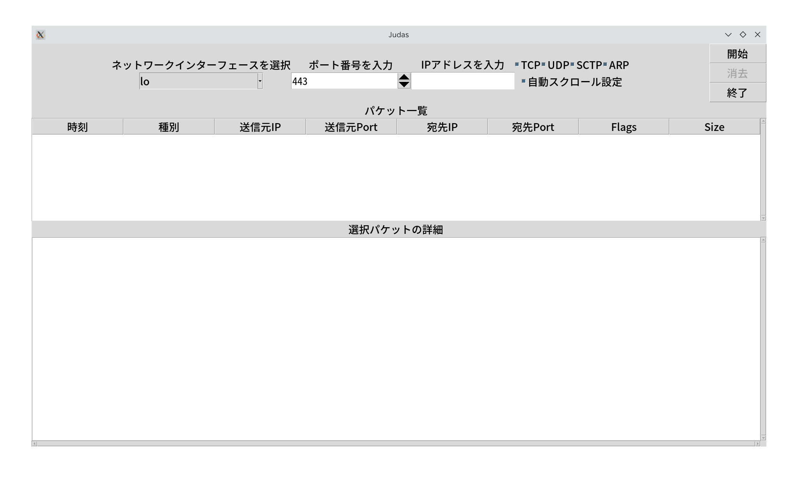
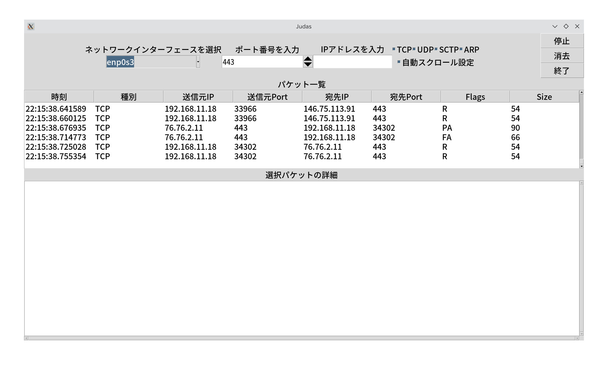
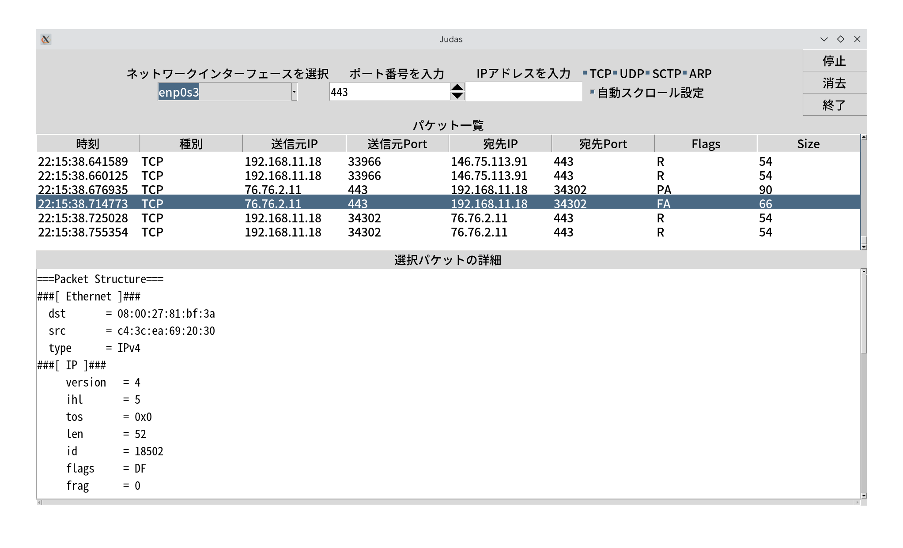
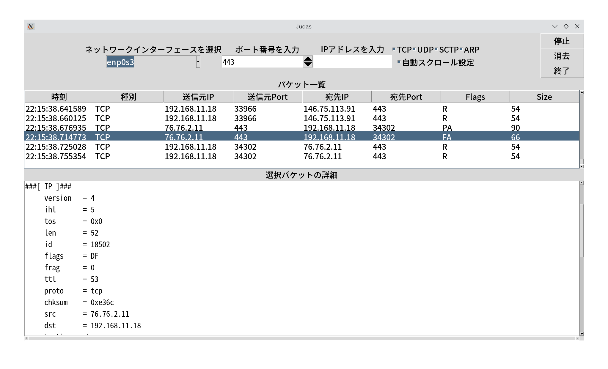
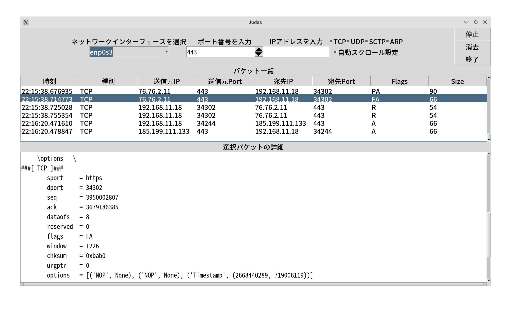
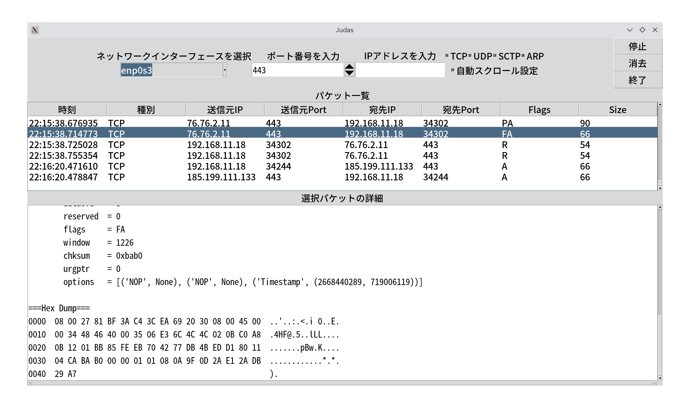

This is a packet capture tool.

I named it “Judas.”

This name is a recursive acronym for 

***“Judas: Ubiquitous Data Analysis System”***

or simply means a peephole.

***Jabberwocky underlies dawns and sunsets.***