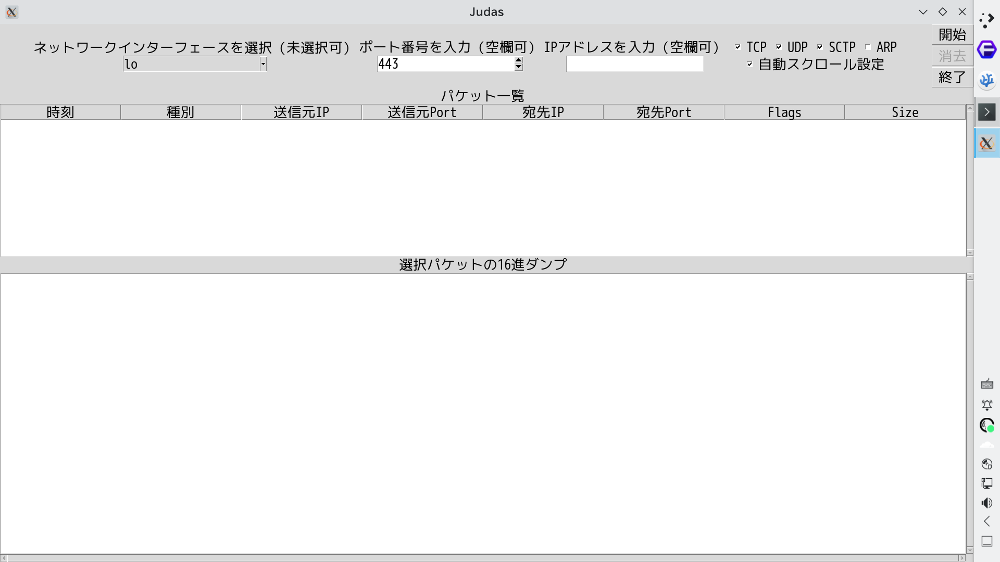
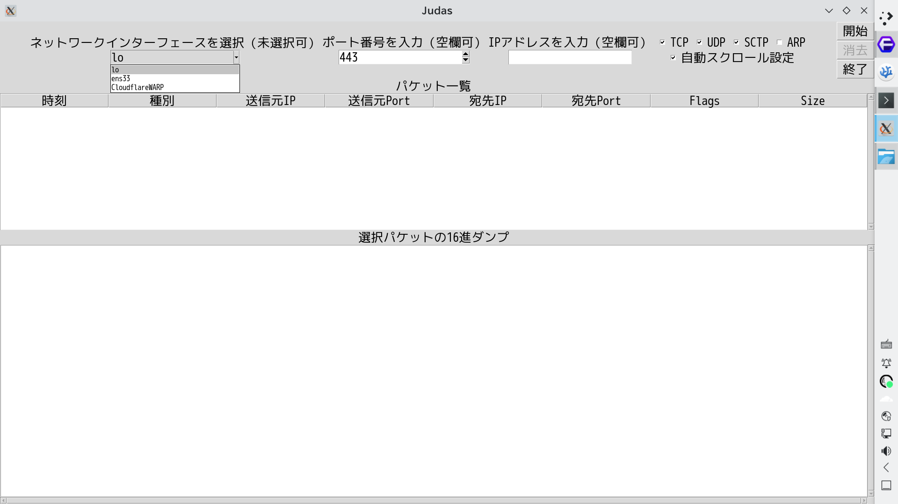
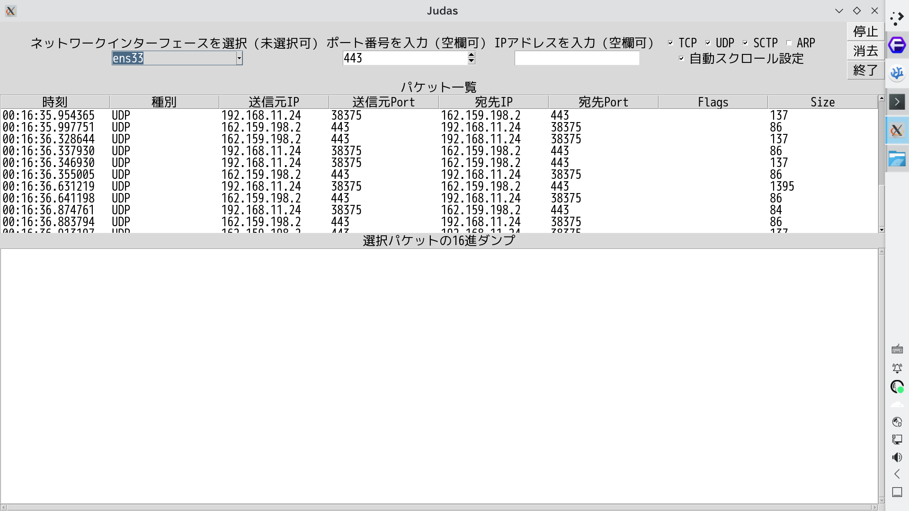
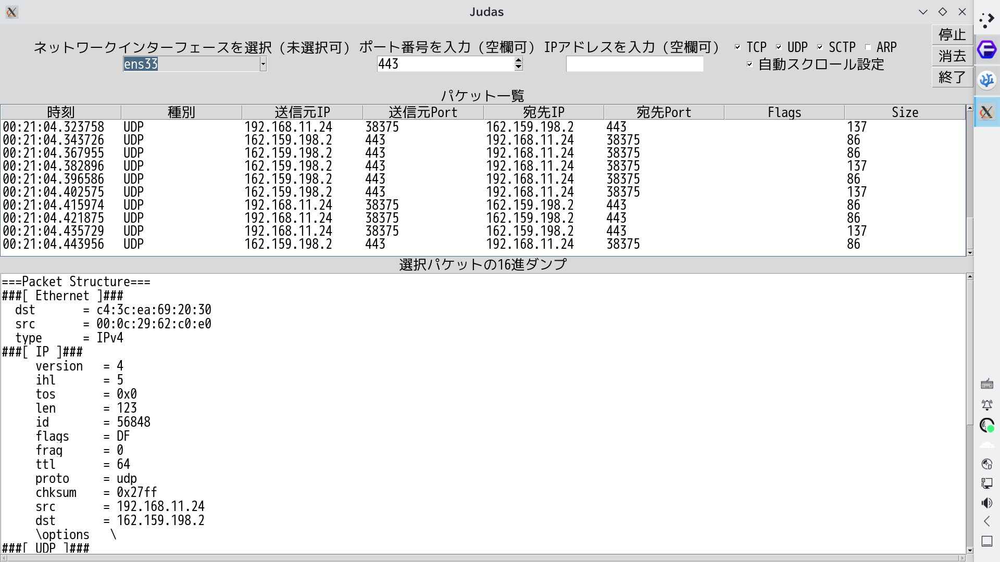

This is a packet capture tool.

I'm studying computer networks, so I thought it would helps me understand them better.

I named it “Judas.”

This name is a recursive acronym for 

***“Judas: Ubiquitous Data Analyzing System”***

or simply means a peephole.

---

---

***Jabberwocky underlies dawns and sunsets.***
